# DSO202 Practical 6: Helm

## 1. Aim

The aim of this practical was to learn how Helm is used to deploy applications on Kubernetes. I first used a published chart to go through the release lifecycle, then wrote my own chart called `webapp`, and then tested how values and chart validation work.

## 2. Scope of this report

This report covers Demo Stages 0 to 5. The copy of the notes I had ends at section 3.2.3.2, before the steps for the later stages, so I did not do Stages 6 to 8. This means the `webapp` chart was rendered and checked with server dry runs, but it was not actually installed on the cluster. The `site/` umbrella chart was also not created.

## 3. Tools used

| Tool | Version or detail |
|---|---|
| Helm | v4.3.0 |
| Kubernetes | v1.36.1 |
| Cluster | kind cluster named `dso202` |
| Published chart | podinfo 6.15.0 |
| Application in my chart | nginx 1.30-alpine |

## 4. Stage 0: Preparing the cluster

When I first checked the setup, Helm was installed correctly but `kubectl` and `helm list` could not reach a cluster. They were trying to connect to `localhost:8080`, which happens when kubectl has no current context.

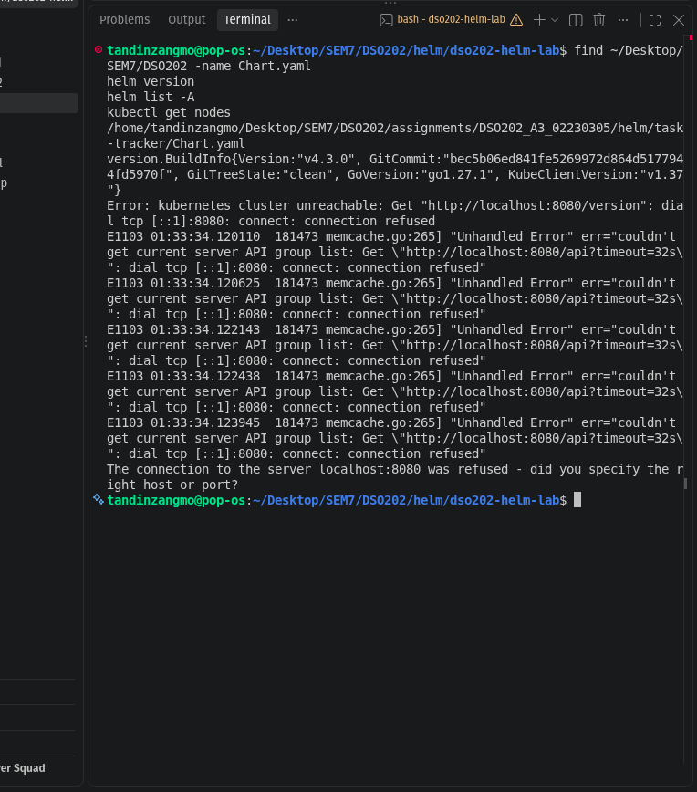

My `dso202` kind cluster already existed, so I started its container again and exported the kubeconfig. After that the context was `kind-dso202`, the node was Ready and `helm list -A` ran without an error.

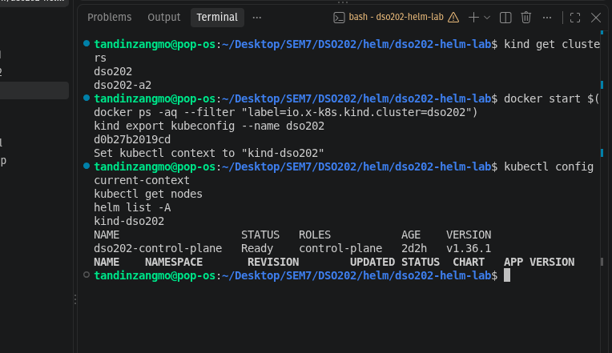

**Difference from the notes:** the notes expect a three node cluster, but my `dso202` cluster has only one node. It still worked for these stages. Port 30080, which the development release needs, is mapped on it as shown in the next screenshot.

## 5. Stage 1: Using a published chart

I added the podinfo repository, searched it and read the chart details before installing. The latest version in the search was 6.17.0, but I used 6.15.0 because that is the version in the notes.

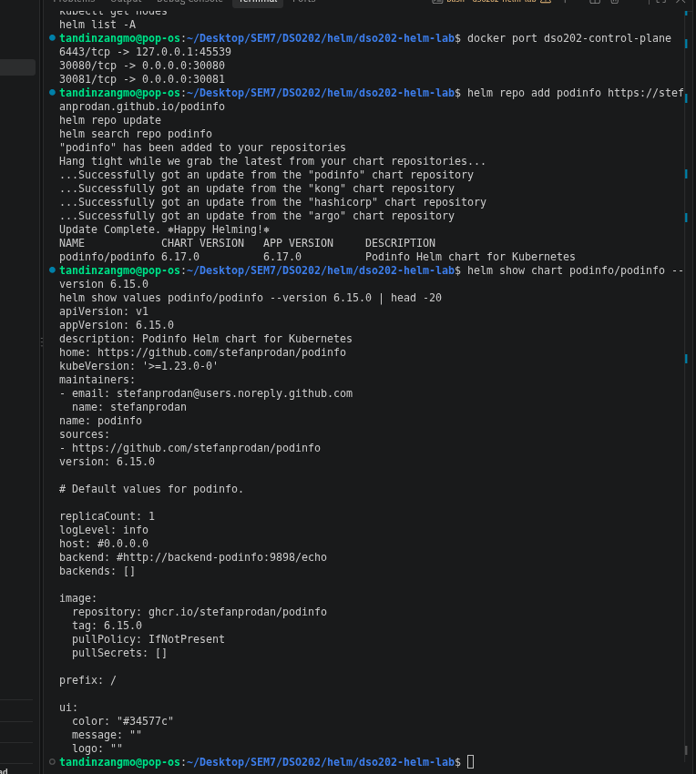

I then installed it as a release called `my-podinfo` with 2 replicas and a custom message.

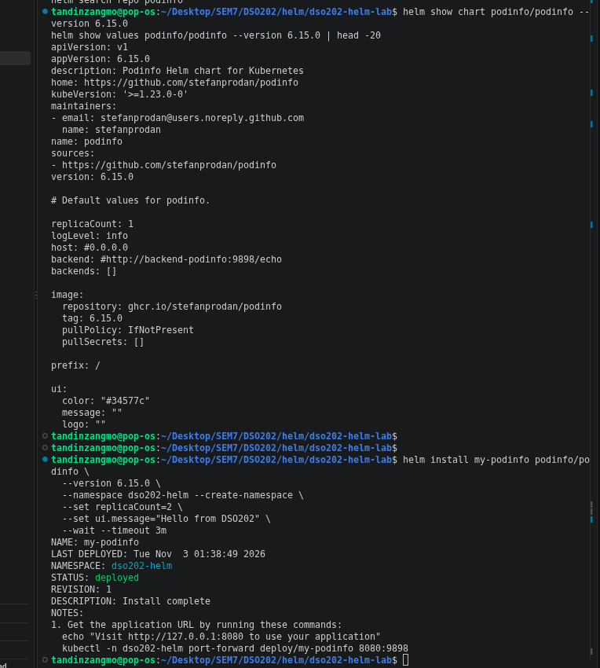

The release was deployed, and the Deployment showed 2/2 Pods running.

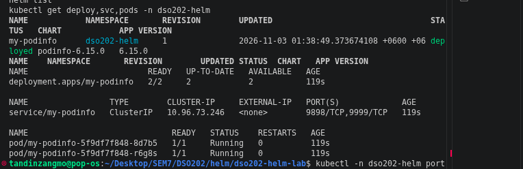

I used a port forward to reach the application from my laptop.

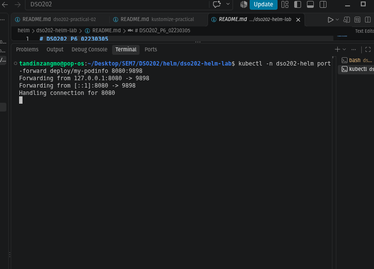

The curl request returned version 6.15.0 and the message "Hello from DSO202". I also inspected the release with `helm status`, `helm get values` and `helm get manifest`. The release record is stored in a Secret called `sh.helm.release.v1.my-podinfo.v1`.

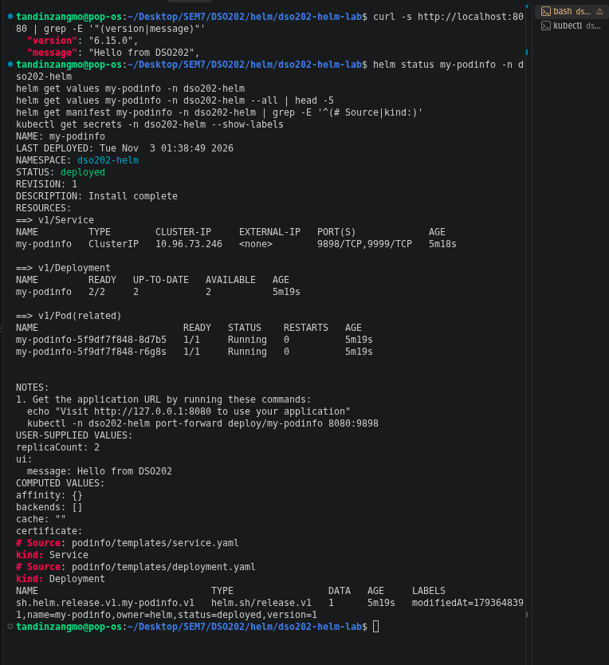

### Upgrade, rollback and history

I upgraded the release with only a new colour value. The upgrade succeeded, but replicas went back to 1 and my message was lost, because Helm started again from the chart defaults. This failure was intended in the practical.

I fixed it by upgrading again with `--reuse-values` and setting the values again. Then I rolled back to revision 1. The rollback did not delete revisions 2 and 3. It created revision 4 as a copy of revision 1, so the full history stays visible.

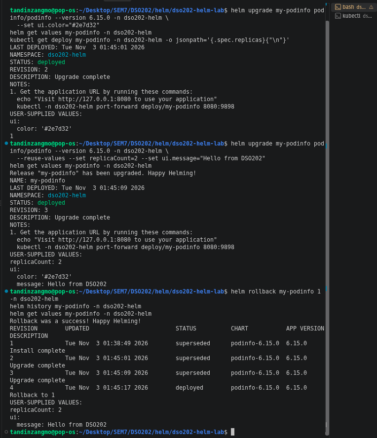

### Uninstall and OCI install

After `helm uninstall`, the Pods were terminating and the release was removed, but the `dso202-helm` namespace stayed because it is not part of the release. I also installed and uninstalled the same chart from an OCI registry, which does not need `helm repo add`.

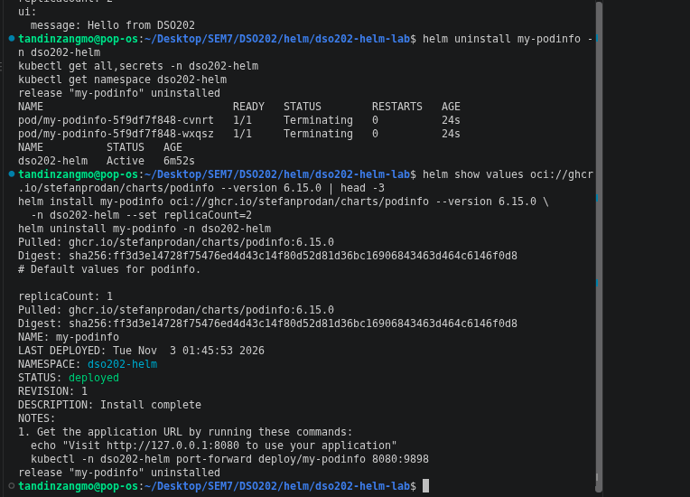

## 6. Stage 2: Chart skeleton

I created the `webapp` chart structure with `Chart.yaml`, `values.yaml`, `.helmignore`, and the `templates`, `templates/tests` and `charts` folders.

In `Chart.yaml`, `version` is the version of the chart and `appVersion` is the version of the application inside it. `appVersion` is quoted so that YAML keeps it as a string.

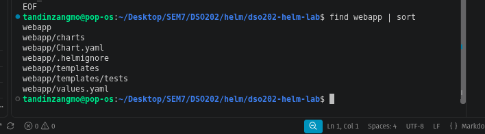

## 7. Stage 3: Writing the templates

I added these files to the chart:

| File | Purpose |
|---|---|
| `_helpers.tpl` | Shared names and labels |
| `configmap.yaml` | The HTML page |
| `deployment.yaml` | Runs nginx and mounts the page |
| `service.yaml` | Gives the Pods a stable address |
| `NOTES.txt` | Instructions printed after install |
| `tests/test-connection.yaml` | Test Pod for `helm test` |

I also created `environments/dev.yaml` and `environments/prod.yaml`.

I rendered the chart locally with `helm template`. It produced the four expected objects: ConfigMap, Service, Deployment and a test Pod. The checksum annotation was `534e2ce7205f6f1d2d13203ea2dbd1ec7235d260e43331302152c76034b4f88b`, the same as in the notes, so my rendered ConfigMap matched. This annotation makes the Pods roll out again when the page content changes.

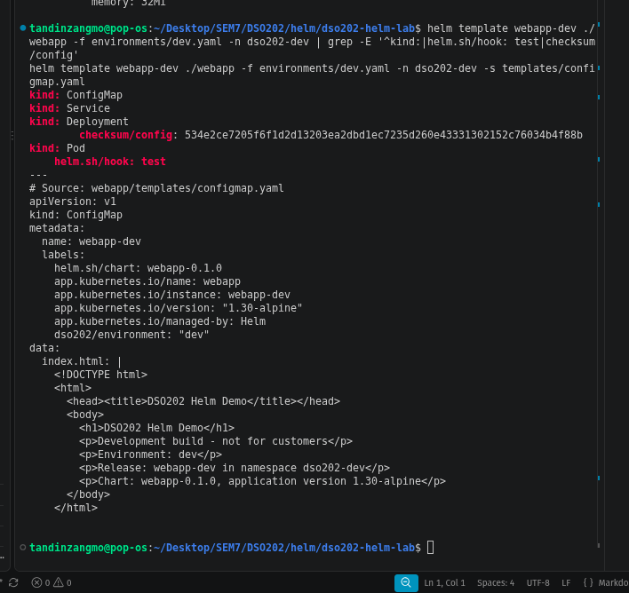

## 8. Stage 4: Values and precedence

I tested how values are merged:

- `--set replicaCount=2` overrode the value in the file.
- With dev and then prod, the result was prod with 3 replicas, but it still had NodePort 30080 from dev, because `prod.yaml` does not set the service.
- With prod and then dev, the result was dev with 1 replica, but it still had the CPU values from prod.
- `--set` rendered the annotation as `true`, while `--set-string` rendered it as `"true"`. Annotation values must be strings.
- Setting `resources.limits=null` removed the limits and kept the requests.

From this I learned that environment files should not be layered on top of each other, because settings leak from one environment to another.

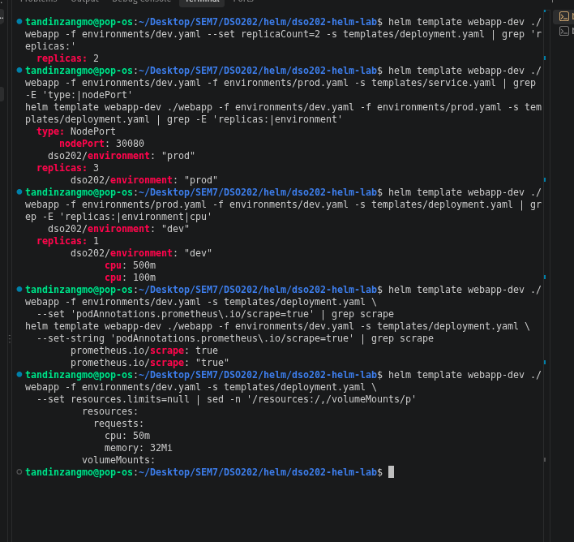

## 9. Stage 5: Validating the chart

In this stage I broke the chart on purpose in four ways to see which check catches each problem.

### Failure 1: Missing required value

Without an environment file, `helm template` stopped with the message `page.environment must be set`. `helm lint --strict` only gave warnings and still exited with code 0, so lint alone is not enough.

### Failure 2 and Failure 3: Indentation and wrong type

Removing `nindent` from the `toYaml` line caused a YAML parse error at line 59. The debug output showed that only the first line of the resources block was indented. I restored the line afterwards.

For Failure 3, I set the image tag to `1.30` without quotes. YAML read it as the number 1.3, so the image became `nginx:1.3` with no warning at all. This is dangerous because the problem would only appear on the cluster.

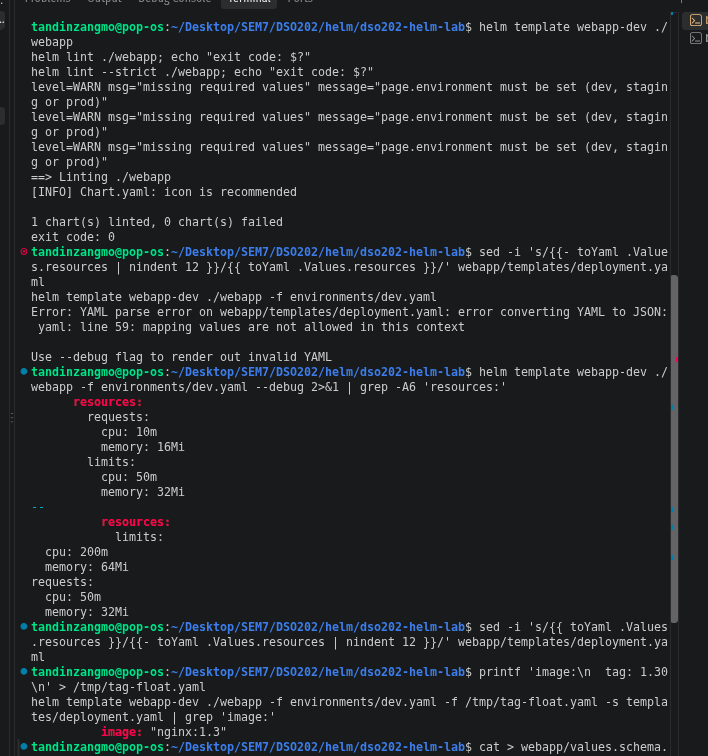

### Fixing with a schema, and Failure 4

To fix Failure 3, I added `webapp/values.schema.json`. The wrong tag and other bad values were then rejected straight away with clear error messages.

For Failure 4, I renamed `replicas` to `replica` in the Deployment. `helm lint` and `helm install --dry-run=server` both passed. Only `helm template` piped to `kubectl apply --dry-run=server` rejected it, with `unknown field "spec.replica"`. I then restored the field, and lint and template passed for both dev and prod.

The `namespaces "dso202-prod" not found` errors in this screenshot appeared because that namespace did not exist yet. They did not stop the unknown field error from showing.

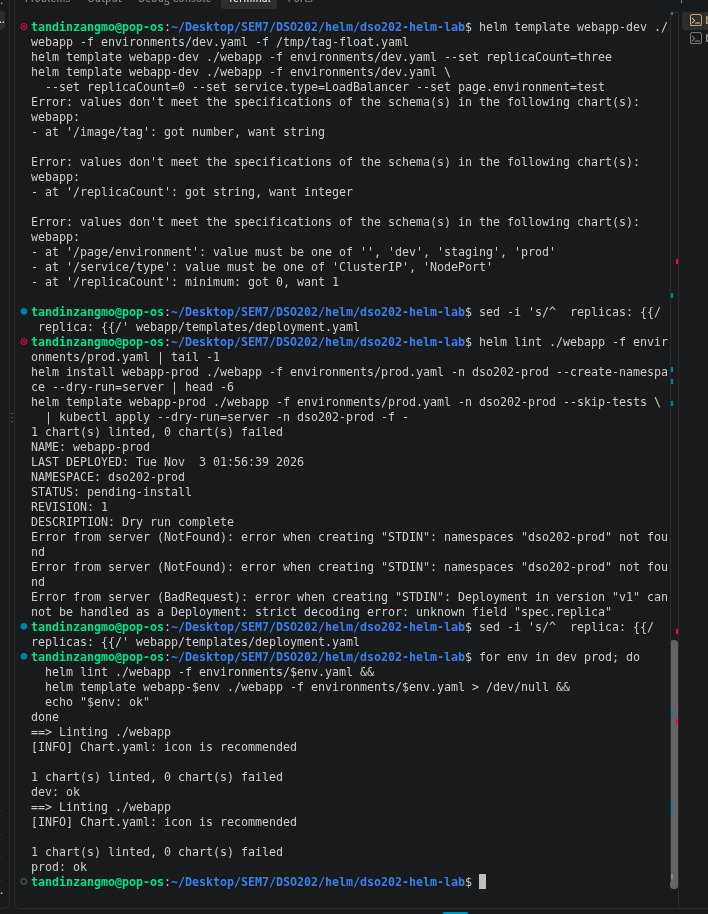

### Final check

Lint and template cannot catch a misspelled field, so I confirmed the fix separately. `grep` showed the correct `replicas` and `toYaml` lines. After creating the namespace, the server dry run accepted the ConfigMap, Service and Deployment.

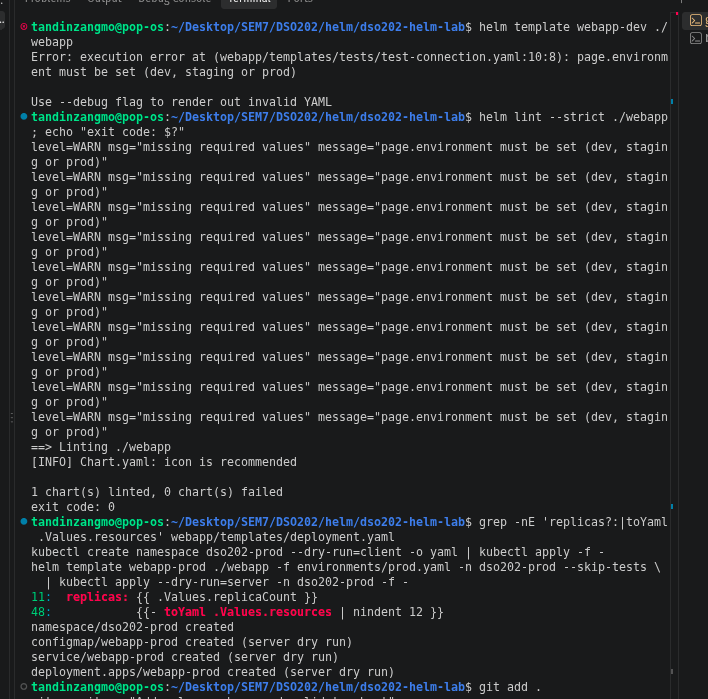

| Check | Missing required value | Wrong type | Bad indentation | Unknown field |
|---|---|---|---|---|
| `helm lint` | Warning only | Not tested | Not tested | No |
| `helm template` | Yes | Yes, with schema | Yes | No |
| `helm install --dry-run=server` | Not tested | Not tested | Not tested | No |
| `helm template` with `kubectl apply --dry-run=server` | Not tested | Not tested | Not tested | Yes |

## 10. Problems I faced

| Problem | Cause | Fix |
|---|---|---|
| kubectl tried to connect to `localhost:8080` | No current cluster context | Started the kind container and ran `kind export kubeconfig --name dso202` |
| Port 8080 was already in use for the port forward | I pressed Ctrl+Z, which only paused the first port forward, so it still held the port | Stopped the paused job and ran the port forward again in a second terminal |
| `namespaces "dso202-prod" not found` in the server dry run | The dry run install does not really create the namespace | Created the namespace before running the final check |

## 11. Conclusion

In this practical I went through the Helm release lifecycle using podinfo, wrote my own `webapp` chart and tested how values are merged. The most useful thing I learned is that no single check is enough. `helm lint` missed problems that `helm template` caught, and only a server dry run through kubectl caught a misspelled field. I also learned that an upgrade with new values can silently lose old ones unless all the values are kept in files.

Stages 6 to 8 are still not done because they are not in my copy of the notes, so the chart has not been installed on the cluster yet.